<div align="center">

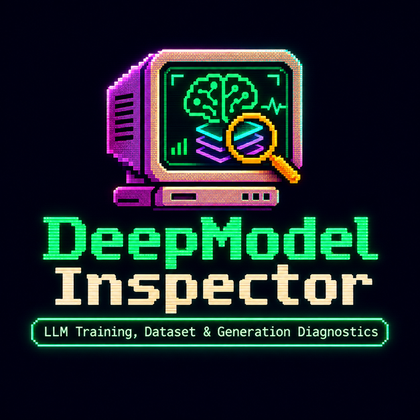

# DeepModel Inspector

### LLM Training, Dataset & Generation Diagnostics

**Forensic, evidence-based diagnostics for Large Language Models — offline, read-only, CPU-first.**

<p>
  
  
  
  
</p>
<p>
  
  
  
  
  
  
</p>

[Features](#-features) ·
[Screenshots](#-screenshots) ·
[Quick start](#-quick-start) ·
[How it works](#-how-it-works) ·
[CLI](#-command-line-interface) ·
[Agent skill](#-agent-skill-agensi) ·
[Docs](#-documentation)

</div>

---

> **Why is my LLM repeating itself? Why is validation loss climbing? Is my test set leaking into training?**
> DeepModel Inspector answers these questions with **measured evidence**, not guesses. It turns training logs,
> datasets, tokenizations, generated outputs and run configs into findings that each carry the **evidence**, the
> **rule** that fired, a **status**, a **recommendation** and the **experiment that would confirm it**.

<table>
<tr>
<td width="33%" valign="top">

### 🔬 Evidence first
Every finding cites the numbers and the file it came from. No invented metrics, no fake confidence percentages.

</td>
<td width="33%" valign="top">

### 🧭 Honest by design
`CONFIRMED` · `POTENTIAL` · `INCONCLUSIVE`. Hypotheses are never presented as proven causes.

</td>
<td width="33%" valign="top">

### 🔒 Private & local
Runs on your machine, read-only, no network calls, no pickle loading, credential files refused.

</td>
</tr>
</table>

---

## 📑 Table of contents

- [Features](#-features)
- [Screenshots](#-screenshots)
- [Quick start](#-quick-start)
- [How it works](#-how-it-works)
- [Finding statuses & severities](#-finding-statuses--severities)
- [Diagnostic rules](#-diagnostic-rules)
- [Supported inputs](#-supported-inputs)
- [Command-line interface](#-command-line-interface)
- [Desktop-style app](#-desktop-style-app)
- [Agent skill (Agensi)](#-agent-skill-agensi)
- [Security & privacy](#-security--privacy)
- [Testing & quality](#-testing--quality)
- [Project structure](#-project-structure)
- [Documentation](#-documentation)
- [Limitations](#-limitations)
- [Roadmap](#-roadmap)
- [Author & license](#-author--license)

---

## ✨ Features

| Area | What it detects / measures |
|---|---|
| 📈 **Training health** | NaN/Inf, loss divergence, overfitting (train ↓ while eval ↑), underfitting, plateaus, loss spikes, LR–spike association, gradient explosion/vanishing (when `grad_norm` is logged), slopes, window stability, perplexity |
| 🗂️ **Dataset quality** | Empty/malformed records, exact duplicates, MinHash/LSH near-duplicates, internal repetition, instruction/messages schema errors, mojibake & control characters, language/script distribution, instruction-like (prompt-injection) content |
| 🧪 **Contamination** | Exact, near-duplicate, prompt-only and 13-gram overlap between train and validation/test — templates excluded, within-split duplication kept separate from leakage |
| 🔤 **Tokenizer efficiency** | Tokens/word (fertility), tokens/char, fragmentation, byte-fallback, UNK, truncation, unused context, cross-tokenizer comparison — from **your** tokenizations, never simulated |
| 💬 **Generation behaviour** | Distinct-1/2/3, n-gram repetition, MATTR, lengths, empty/short/truncated outputs, cross-output similarity, bootstrap comparison of decoding configs, grounding against provided references |
| ⚖️ **Experiment comparison** | Hyperparameter diff, metric regressions with direction, compatibility guard (tokenizer / vocab / eval set / protocol), curve best vs. final |
| 💾 **Checkpoint metadata** | safetensors headers (tensors, parameters, dtypes) and JSON configs only — pickle files are listed, never loaded |
| 🧠 **Root-cause engine** | Question intents in English and Portuguese, cross-artifact hypotheses, prioritized experiments, missing-artifact requests |
| 📄 **Reports** | JSON, Markdown and static HTML with 11 standard sections |

---

## 🖼️ Screenshots

> Real screenshots of the local app running on Windows 11 with the bundled **DEMO** lab (synthetic data, real engine).

<div align="center">

### Command Center
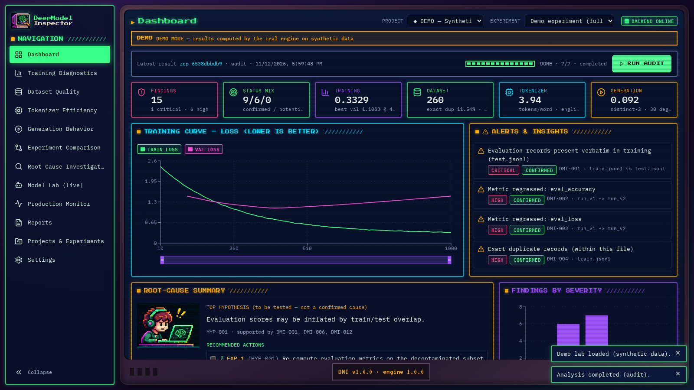

### Root-Cause Investigation
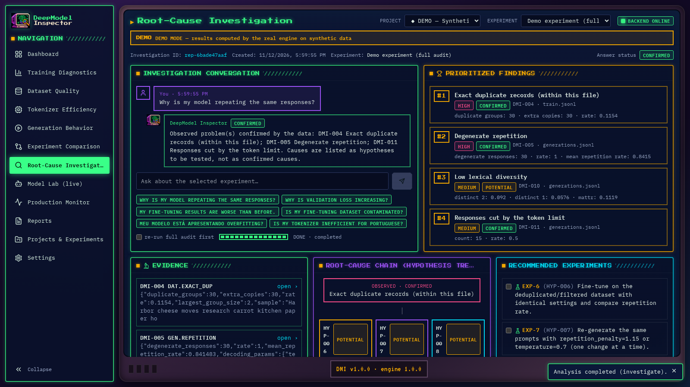

</div>

<table>
<tr>
<td width="50%"><b>Training Diagnostics</b><br/>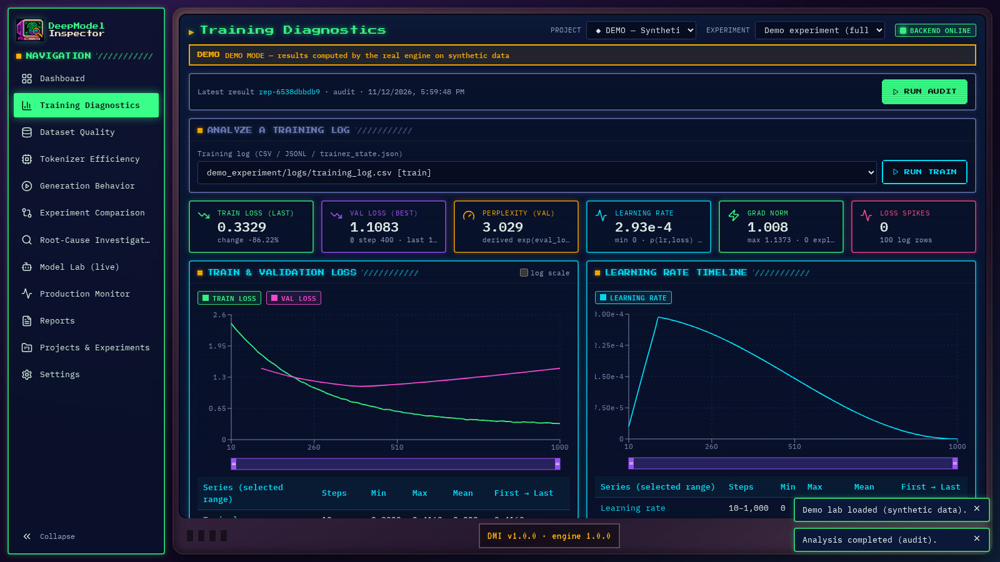</td>
<td width="50%"><b>Dataset Quality</b><br/>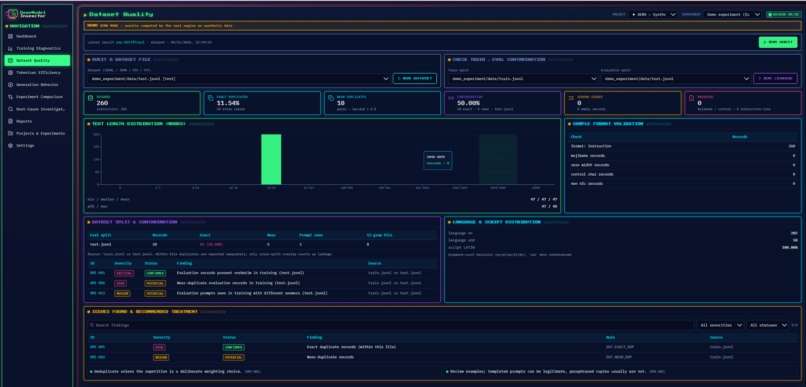</td>
</tr>
<tr>
<td width="50%"><b>Tokenizer Efficiency</b><br/>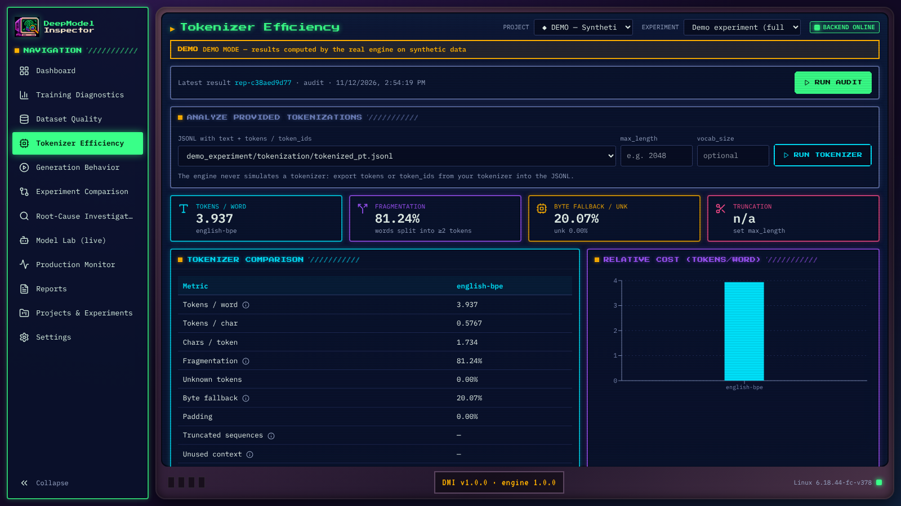</td>
<td width="50%"><b>Generation Behavior</b><br/>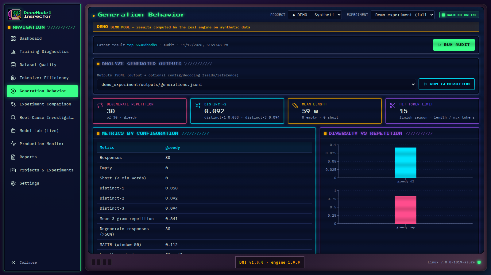</td>
</tr>
<tr>
<td width="50%"><b>Experiment Comparison</b><br/>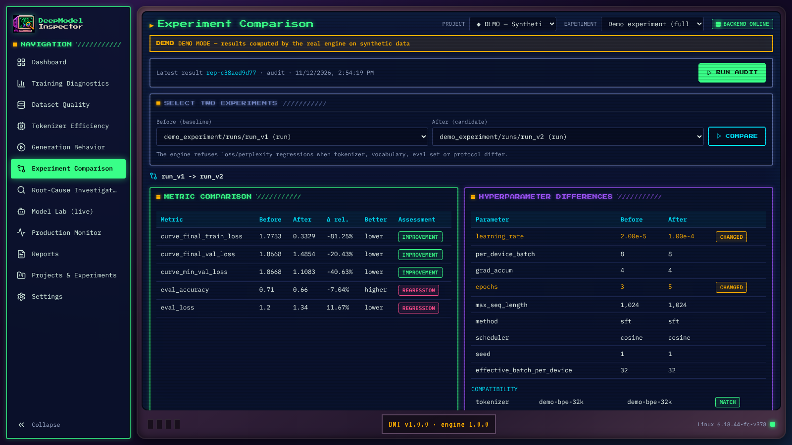</td>
<td width="50%"><b>Reports & Exports</b><br/>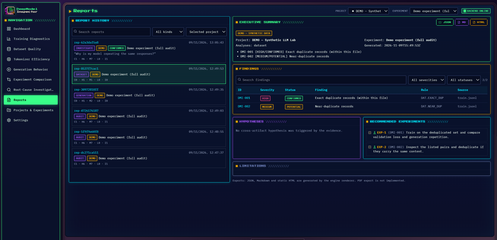</td>
</tr>
<tr>
<td width="50%"><b>Projects & Experiments</b><br/>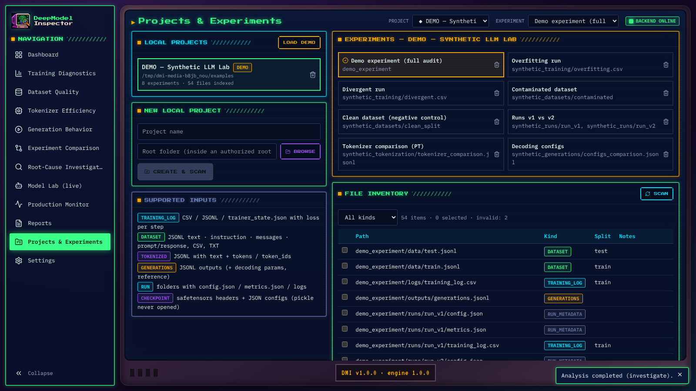</td>
<td width="50%"><b>Settings</b><br/>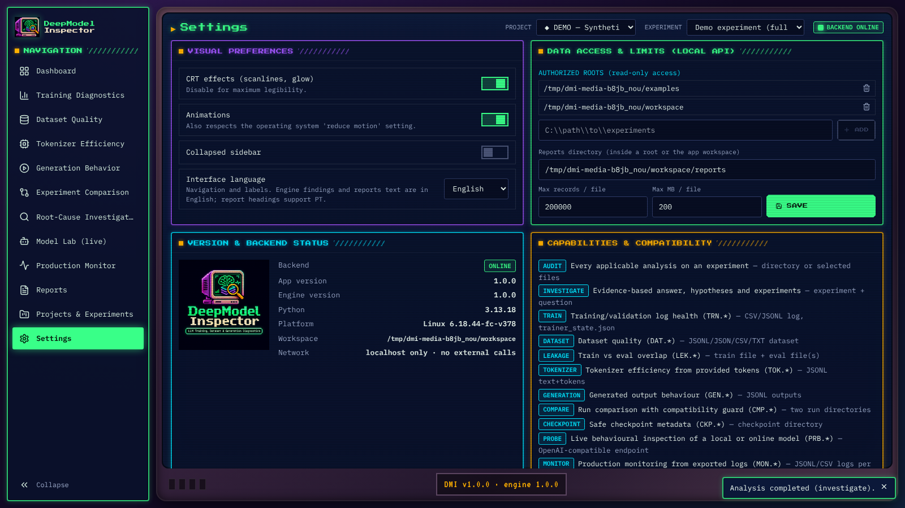</td>
</tr>
</table>

<details>
<summary><b>🎨 Design references (brand identity & prototypes)</b></summary>

<br/>

The UI follows the "Retro AI Lab / CRT Gaming Terminal" identity. Approved references live in
[`design/references/`](design/references/) and the design system is documented in
[`docs/ui-design-system.md`](docs/ui-design-system.md).

| Token | Hex | Use |
|---|---|---|
|  Phosphor Green | `#39FF88` | primary, success, active |
|  Cyan | `#00E5FF` | interface, info, focus |
|  Purple | `#A255FF` | accent, hypotheses |
|  Amber | `#FFB000` | attention, warnings |
|  Navy | `#0B1839` | panels |
|  Console Black | `#1A1030` | background |

Typography: **Press Start 2P** (titles) · **IBM Plex Mono** (data) · **VT323** (terminal details) — all SIL OFL, bundled locally.

</details>

---

## 🚀 Quick start

### Requirements

| Component | Version | Needed for |
|---|---|---|
| Python | 3.11+ (tested 3.11 and 3.13) | engine, CLI, app API |
| FastAPI + uvicorn | installed via `.[app]` | desktop-style app |
| Node.js | 18+ (optional) | only to rebuild/develop the UI (a production build is included) |

### 1 · Install

```powershell
git clone https://github.com/ViniciusKanh/Skill-DeepModel-Inspector.git
cd Skill-DeepModel-Inspector
py -3.13 -m venv .venv
.\.venv\Scripts\Activate.ps1          # Linux/macOS: source .venv/bin/activate
pip install -e ".[app]"               # engine + local app (add ,dev for tests)
```

### 2 · Launch the app

```powershell
.\scripts\Start-DeepModel.ps1          # → http://127.0.0.1:8765
```
Linux/macOS: `./scripts/start-deepmodel.sh`

### 3 · Try the demo (≈ 2 minutes)

1. Click **LOAD DEMO** → a *DEMO — Synthetic LLM Lab* project with 8 experiments appears.
2. Click **RUN AUDIT** → real progress, real engine.
3. Open **Root-Cause Investigation** and ask *"Why is my model repeating the same responses?"*.
4. Click a finding to inspect evidence and supporting records, then export **JSON / Markdown / HTML**.

<details>
<summary><b>Expected results per demo experiment</b></summary>

| Experiment | Expected finding |
|---|---|
| Demo experiment (full audit) | verbatim test leakage (CRITICAL), overfitting, degenerate repetition, regression v1 → v2, tokenizer fertility |
| Overfitting run | `TRN.OVERFIT` — CONFIRMED |
| Divergent run | `TRN.NONFINITE` — CRITICAL, `TRN.DIVERGENCE` |
| Contaminated dataset | `LEK.EXACT` — CRITICAL (10 exact, 5 near, 3 reused prompts) |
| Clean dataset (negative control) | `LEK.CLEAN` only — no false positive |
| Runs v1 vs v2 | `CMP.REGRESSION` on `eval_accuracy` and `eval_loss` |
| Tokenizer comparison (PT) | English BPE costs 3.94 tokens/word vs. 1.0 |
| Decoding configs | greedy repeats significantly more than sampling (bootstrap CI) |

</details>

---

## 🧩 How it works

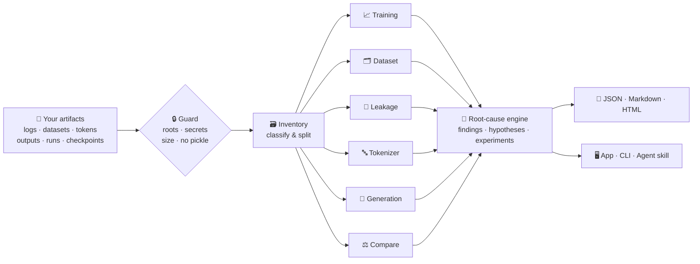

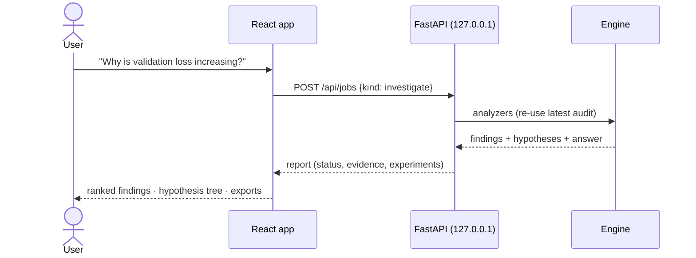

One engine, three front doors:

| Interface | Best for | Entry point |
|---|---|---|
| 🖥️ **Desktop-style app** | visual exploration, demos, reports | `scripts/Start-DeepModel.ps1` |
| ⌨️ **CLI** | automation, CI, scripts | `deepmodel <command>` |
| 🤖 **Agent skill** | Claude Code, Codex and other agents | `agensi/deepmodel-inspector/SKILL.md` |

---

## 🚦 Finding statuses & severities

| Status | Meaning |
|---|---|
|  | The documented rule is satisfied by the data — an **observed fact**, never a proven cause |
|  | Indicators support a possible problem; run the listed confirmation step |
|  | Not enough information (missing columns, too few points, incompatible runs) |

| Severity | Impact |
|---|---|
|  | results invalid or training broken |
|  | likely materially wrong conclusions |
|  | quality or efficiency problem |
|  | minor |
|  | context, no action needed |

Every finding contains: `id`, `rule`, `category`, `severity`, `status`, `evidence`, `source`, `explanation`,
`recommendation` and, when useful, `confirmation`.

---

## 📐 Diagnostic rules

<details>
<summary><b>Training — TRN.*</b></summary>

| Rule | Condition |
|---|---|
| `TRN.NONFINITE` | NaN/Inf in loss, eval loss or grad norm → CONFIRMED / CRITICAL |
| `TRN.DIVERGENCE` | last-20% mean > first-20% mean and > 1.5× minimum |
| `TRN.OVERFIT` | eval loss rises ≥ 5% after its minimum (≥ 2 increases) while train slope < 0 |
| `TRN.UNDERFIT` | < 10% improvement first → last window |
| `TRN.PLATEAU` | ≥ 10% overall improvement but < 1% over the last third |
| `TRN.INSTABILITY` | ≥ 3 robust spikes vs. a centred 7-point median |
| `TRN.LR_HIGH` | most spikes occur at LR ≥ 90% of peak (association only) |
| `TRN.GRAD_EXPLOSION` / `GRAD_VANISH` | grad norm > 10× median / collapses below 0.1% |
| `TRN.NO_VALIDATION` | overfitting not assessed without eval loss |

</details>

<details>
<summary><b>Dataset — DAT.* · Leakage — LEK.*</b></summary>

| Rule | Condition |
|---|---|
| `DAT.EXACT_DUP` | identical after NFKC + casefold + punctuation normalization |
| `DAT.NEAR_DUP` | MinHash (64 seeded permutations, LSH 16×4), verified Jaccard ≥ 0.8 |
| `DAT.REPETITIVE` | > 50% repeated word 3-grams inside a record |
| `DAT.STRUCTURE` | invalid roles, missing outputs, no assistant turn… |
| `DAT.ENCODING` | mojibake / control characters |
| `DAT.INSTRUCTION_LIKE` | text trying to override model instructions — flagged, never followed |
| `LEK.EXACT` | eval record verbatim in train → CONFIRMED |
| `LEK.NEAR` / `LEK.PROMPT` / `LEK.NGRAM` | near copies, reused prompts, ≥ 50% 13-gram overlap (templates excluded) |

</details>

<details>
<summary><b>Tokenizer — TOK.* · Generation — GEN.* · Compare — CMP.*</b></summary>

| Rule | Condition |
|---|---|
| `TOK.FERTILITY` | tokens/word > 2.0 |
| `TOK.BYTE_FALLBACK` / `TOK.UNK` | `<0xNN>` tokens > 2% / unknown tokens present |
| `TOK.TRUNCATION` | > 5% of sequences reach `max_length` |
| `GEN.REPETITION` | ≥ 10% of responses repeat > 50% of their 3-grams |
| `GEN.LOW_DIVERSITY` | corpus distinct-2 < 0.3 |
| `GEN.TRUNCATED` | `finish_reason = length` or token limit reached |
| `GEN.UNSUPPORTED` | sentences not supported by the provided reference |
| `GEN.CONFIG_DIFF` | bootstrap 95% CI of repetition difference excludes 0 |
| `CMP.INCOMPATIBLE` | tokenizer / vocab / eval set / protocol differ → no regression claimed |
| `CMP.REGRESSION` | metric worse by > 1% in its "better" direction |

</details>

Full thresholds and formulas: [`docs/diagnostic-methodology.md`](docs/diagnostic-methodology.md).

---

## 📥 Supported inputs

| Kind | Format | Example |
|---|---|---|
| Training log | CSV / JSONL / HF `trainer_state.json` | `step,loss,eval_loss,learning_rate,grad_norm` |
| Dataset | JSONL `text`, `instruction/input/output`, `messages`, `prompt/completion`; CSV; TXT | `{"messages":[{"role":"user",…},{"role":"assistant",…}]}` |
| Tokenization | JSONL `text` + `tokens` and/or `token_ids` | `{"text":"…","tokens":["▁A","▁inform","ação"]}` |
| Generations | JSONL `output` (+ `config`, `temperature`, `finish_reason`, `reference`) | `{"prompt":"…","output":"…","temperature":0.7}` |
| Runs | folder with `config.json`, `metrics.json`, loss log | `{"learning_rate":2e-5,"tokenizer":"bpe-32k"}` |
| Checkpoint | `.safetensors` headers + JSON configs | — |

Name splits with `train`, `val`/`valid`/`dev`, `test`/`eval` so leakage checks can pair them.
Details: [`agensi/deepmodel-inspector/references/input-formats.md`](agensi/deepmodel-inspector/references/input-formats.md).

<details>
<summary><b>Example scenario layout</b></summary>

```
my-finetune/
├── logs/trainer_state.json
├── data/train.jsonl
├── data/test.jsonl
├── outputs/generations.jsonl
├── tokenization/tokens.jsonl
└── runs/
    ├── v1/ (config.json, metrics.json)
    └── v2/ (config.json, metrics.json)
```

</details>

---

## ⌨️ Command-line interface

```bash
deepmodel scan        --input ./experiment
deepmodel train       --logs  ./logs/trainer_state.json
deepmodel dataset     --input ./data/train.jsonl
deepmodel leakage     --train ./data/train.jsonl --test ./data/test.jsonl
deepmodel tokenizer   --input ./tokenized.jsonl --max-length 2048
deepmodel generation  --input ./outputs.jsonl
deepmodel compare     --before ./runs/v1 --after ./runs/v2
deepmodel checkpoint  --input ./checkpoint-1000
deepmodel audit       --input ./experiment --output ./reports        # audit.json + .md + .html
deepmodel report      --input ./reports/audit.json --format markdown
deepmodel investigate --input ./experiment --question "Why is validation loss increasing?"
```

| Option | Description |
|---|---|
| `--format json\|markdown\|html` | output format |
| `--lang en\|pt` | report headings language |
| `--output` | file (or directory for `audit`) |
| `--root DIR` | authorized root (repeatable; default = current directory) |
| `--max-mb`, `--max-records` | input limits |

Exit codes: `0` ok · `2` invalid input · `3` security refusal.

<details>
<summary><b>Example answer (real output on the demo)</b></summary>

```text
Question: Why is my LLM repeating the same sentences?
Answer status: CONFIRMED

DMI-005 [HIGH/CONFIRMED] Degenerate repetition — 30/30 responses, mean repetition 0.84,
        temperature 0.0, repetition_penalty 1.0, do_sample False
DMI-011 [MEDIUM/CONFIRMED] Responses cut by the token limit — 15/30
DMI-004 [HIGH/CONFIRMED] Exact duplicate records in SFT data — 30 extra copies (11.5%)

Hypotheses (POTENTIAL — to be tested):
  HYP-006 Repetitive or duplicated training targets may teach the model to repeat.
  HYP-007 Decoding settings that favour loops (temperature ≤ 0.3, penalty ≤ 1.0, greedy).
  HYP-008 The model may fail to emit EOS and loops until the token limit.

Next experiment: re-generate the same prompts with repetition_penalty=1.15 or temperature=0.7 (one change at a time).
```

</details>

---

## 🖥️ Desktop-style app

A local web app (React + TypeScript + Vite + Tailwind + Recharts, served by FastAPI on `127.0.0.1`) with 10 screens:
**Dashboard · Training · Dataset · Tokenizer · Generation · Compare · Investigate · Reports · Projects · Settings**.

- Interactive charts: series toggles, range zoom (brush), tooltips and range statistics.
- Real job progress and cooperative cancellation; indeterminate loaders when progress is unknown.
- Evidence modal with redacted supporting records; exports to JSON / Markdown / HTML.
- **DEMO** mode clearly labelled; CRT effects and animations can be turned off; EN/PT interface labels.

```powershell
.\scripts\Start-DeepModel.ps1 -Port 8800      # custom port
.\scripts\Start-DeepModel.ps1 -Dev            # Vite dev server (Node.js 18+)
.\scripts\Build-Frontend.ps1                  # typecheck + tests + production build
```

User guide: [`docs/frontend-user-guide.md`](docs/frontend-user-guide.md) ·
Architecture: [`docs/frontend-architecture.md`](docs/frontend-architecture.md)

---

## 🤖 Agent skill (Agensi)

The `agensi/deepmodel-inspector/` folder is a self-contained skill for Claude Code, Codex and other agents:
`SKILL.md` + **9 standalone, standard-library scripts** generated from the engine (`tools/build_skill.py`), so
results are identical to the CLI.

| Script | Purpose |
|---|---|
| `dmi_training.py` · `dmi_dataset.py` · `dmi_leakage.py` | training, dataset and contamination analyses |
| `dmi_tokenizer.py` · `dmi_generation.py` · `dmi_compare.py` | tokenizer, generation and run comparison |
| `dmi_checkpoint.py` | safe checkpoint metadata |
| `dmi_investigate.py` · `dmi_report.py` | consolidation, hypotheses, Markdown/HTML report |

```bash
python tools/package_agensi.py     # validate, run each script in isolation, build dist/ ZIP + SHA-256
```

The skill package does **not** include the app; both are distributed separately.

---

## 🔒 Security & privacy

- **Read-only** on analyzed files; outputs never overwrite inputs.
- **Path confinement** to authorized roots; traversal attempts refused.
- **Secrets refused**: `.env`, keys, `.ssh`, `.aws`, credential files.
- **No unsafe deserialization**: pickle formats (`.bin`, `.pt`, `.ckpt`, `.pkl`) are never opened.
- **No network**: no outbound calls; the app API binds to `127.0.0.1` with TrustedHost and restricted CORS.
- **Data is data**: instruction-like content in datasets is flagged, never executed; HTML output is escaped.
- **Redacted evidence**: e-mails, long numbers and key-like strings are masked in samples.

---

## ✅ Testing & quality

| Suite | Command | Result |
|---|---|---|
| Engine (Python 3.13 / 3.11) | `pytest -q` | 68 passed · 92% line coverage |
| Engine on Windows 11 (Python 3.13) | `pytest -q` | 68 passed |
| Local API | `pytest tests/test_api.py` | 9 passed |
| Browser E2E (Playwright) | `pytest tests/e2e` | 6 passed — full demo flow, error states, 4 viewports |
| Frontend | `npm run typecheck && npm test && npm run build` | 0 TS errors · 8 passed · build OK |
| Lint | `ruff check` · `ruff format --check` | clean |
| Skill isolation | `python tools/package_agensi.py` | 12/12 isolated runs OK |

```powershell
pip install -e ".[dev,app,ui-test]"
python examples\generate_synthetic.py
pytest -q
```

Details: [`docs/validation-results.md`](docs/validation-results.md) · [`docs/frontend-validation.md`](docs/frontend-validation.md)

---

## 🗂️ Project structure

```
deepmodel-inspector/
├── src/deepmodel_inspector/   # engine: analyzers, parsers, diagnostics, reporting, security, CLI
├── backend/                   # FastAPI local API (api / schemas / services)
├── frontend/                  # React app (src/, dist/ production build)
├── agensi/deepmodel-inspector # commercial agent skill (SKILL.md, scripts, references, templates)
├── tools/                     # build_skill.py, package_agensi.py
├── examples/                  # reproducible synthetic scenarios + sample reports
├── tests/                     # engine, API, skill parity and Playwright E2E tests
├── scripts/                   # Start-DeepModel.ps1, Build-Frontend.ps1, start-deepmodel.sh
├── design/references/         # approved brand & UI prototypes
└── docs/                      # methodology, architecture, guides, validation, screenshots
```

---

## 📚 Documentation

| Document | Content |
|---|---|
| [Diagnostic methodology](docs/diagnostic-methodology.md) | every rule, threshold and formula |
| [Architecture](docs/architecture.md) | engine design, engine ↔ skill parity |
| [Frontend architecture](docs/frontend-architecture.md) | API endpoints, data flow, security |
| [UI design system](docs/ui-design-system.md) | tokens, typography, components, accessibility |
| [App user guide](docs/frontend-user-guide.md) | install, demo, your own data |
| [Validation results](docs/validation-results.md) | real test runs and checksums |
| [Limitations](docs/limitations.md) | what the tool does **not** do |
| [Agensi listing](docs/agensi-listing.md) · [compliance](docs/agensi-compliance.md) · [publishing](docs/PUBLISH_AGENSI.md) | marketplace material |
| [Changelog](CHANGELOG.md) | version history |

---

## ⚠️ Limitations

- Duplicate, leakage and grounding checks are **lexical**, not semantic (paraphrase/translation not detected).
- Hallucination checks only compare against **references you provide**.
- Thresholds are documented heuristics validated on synthetic scenarios — tune them for your setting.
- Single-run comparisons do not establish statistical significance.
- The investigation is **rule-based** over computed evidence — not a generative chatbot.
- Pure-Python near-duplicate search is capped at 20,000 records per file.

---

## 🗺️ Roadmap

- [x] Engine with training, dataset, leakage, tokenizer, generation, compare and checkpoint analyzers
- [x] Root-cause engine with EN/PT question intents
- [x] Agent skill with standalone scripts and validated ZIP
- [x] Local desktop-style app with DEMO mode
- [ ] Semantic near-duplicate / contamination detection (optional embeddings)
- [ ] PDF export
- [ ] Optional local LLM summarization of reports

---

## 👤 Author & license

<table>
<tr>
<td></td>
<td>

**Vinicius de Souza Santos**
Data Analyst & BI specialist · M.Sc. student in Computer Science (AI & data mining)
GitHub: [@ViniciusKanh](https://github.com/ViniciusKanh)

</td>
</tr>
</table>

**Proprietary software — © 2026 Vinicius de Souza Santos. All rights reserved.**
No license is granted to use, copy, modify or distribute this code without written permission.
A commercial license draft is in [`docs/LICENSE-COMMERCIAL-DRAFT.md`](docs/LICENSE-COMMERCIAL-DRAFT.md).

<div align="center">

<sub>Built with Python, FastAPI, React and a lot of phosphor green. ▮</sub>

</div>
