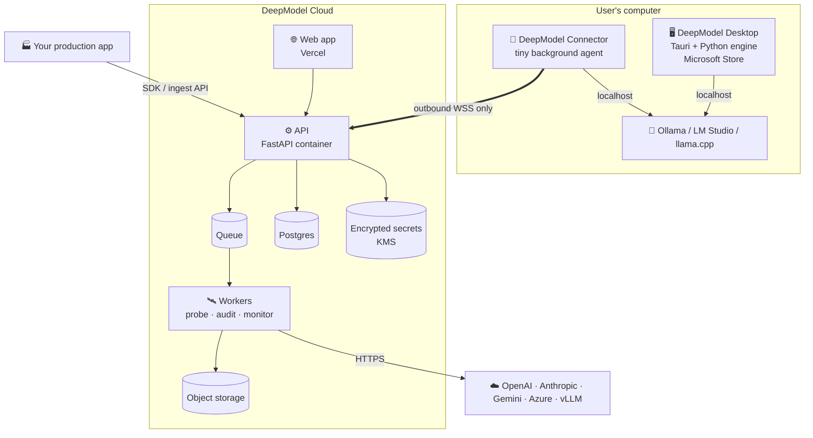

# Deployment Architecture — Desktop (Microsoft Store), Cloud (Vercel) and Connector

> Status: **architecture proposal** (2026-11-12). The local app, live probe, connection wizard and monitor exist today;
> the cloud edition, connector agent and Store packaging below are **not built yet**. Provider limits and Store
> policies change — verify the current Vercel and Microsoft Partner Center documentation before implementing.

## 1. The constraint that shapes everything

The focus of the product is **connecting to and inspecting an LLM**. Models live in two places:

| Where the model runs | Example | Who can reach it |
|---|---|---|
| The user's computer | Ollama, LM Studio, llama.cpp on `localhost` | only software running **on that computer** |
| A provider / company server | OpenAI, Anthropic, Gemini, Azure, a vLLM cluster | any server with the URL and an API key |

A website hosted on Vercel runs on Vercel's servers: it **cannot** call `http://localhost:11434` on the user's PC.
Therefore one edition alone cannot serve both cases well. The design uses **three pieces that share the same engine**:

## 2. Edition A — Desktop app (local-first, Microsoft Store)

Best for: local models, private datasets, non-technical users ("install and click"), offline use.

| Layer | Choice | Reason |
|---|---|---|
| Shell | **Tauri 2** (WebView2 on Windows) | small installer (~10–20 MB vs. ~150 MB Electron), reuses the existing React build unchanged |
| Engine/API | existing FastAPI backend frozen with **PyInstaller** as a Tauri *sidecar* | no Python install needed; same code as today |
| Packaging | **MSIX** (Store) and a signed **MSI/EXE** for direct download | the Store also lists classic Win32 installers — verify current Partner Center rules |
| Updates | Store updates (MSIX) / Tauri updater (direct download) | |
| Data | `%LOCALAPPDATA%\DeepModelInspector\workspace` | per-user, no admin rights |

Startup flow: Tauri starts the sidecar on a random free localhost port with a per-session token → the UI talks to it
with that token (prevents other local software from using the API) → on exit the sidecar is stopped.

Microsoft Store checklist: Partner Center developer account; app name reservation; MSIX package (Store signs it) or
signed installer; privacy policy URL (local-first: "no data leaves the device unless you connect an online model");
age rating questionnaire; screenshots (we have them); support contact; declare network use for online providers.

## 3. Edition B — DeepModel Cloud (Vercel + API + workers)

Best for: teams, online models, scheduled health checks, production monitoring from many apps.

| Component | Choice | Notes |
|---|---|---|
| Web UI | **Vercel** (static Vite build of the same React app) | CDN, previews per branch, custom domain |
| Auth | Clerk / Auth.js / Supabase Auth | organizations, roles (owner, engineer, viewer) |
| API | same **FastAPI** code in a container (Render, Fly.io, Railway, Google Cloud Run or Azure Container Apps) | long-lived process; Vercel Functions have execution-time limits and an ephemeral filesystem, so a ~44-call probe or a large audit should not run inside a function |
| Jobs | Queue (Redis + RQ/Celery, or Cloud Tasks) + **workers** | probe, audit, monitor; real progress via the job table |
| Scheduler | cron (platform cron or Vercel Cron calling an API route that enqueues jobs) | "inspect my model every day at 07:00" |
| Database | **Postgres** (Neon / Supabase) | orgs, users, projects, targets, jobs, report metadata, alert rules |
| Files | object storage (S3 / Cloudflare R2 / Vercel Blob) | uploaded datasets/logs, reports (JSON/MD/HTML) |
| Secrets | provider API keys encrypted with a KMS key (envelope encryption); decrypted only inside workers | never returned to the browser, never logged |
| Ingestion | `POST /v1/ingest` (JSONL batches) + Python/JS SDK + OpenTelemetry GenAI importer | production monitoring without exporting files by hand |
| Alerts | e-mail, Slack/Teams webhook | from `MON.*` / `PRB.*` findings with severity ≥ rule |
| Billing (later) | Stripe | plans by number of models / monitored requests |

Engine changes needed for cloud: replace the local `Store` (JSON files) with a repository over Postgres + object
storage; tenant id on every row; job runner backed by the queue; `safe_input_path` replaced by "object belongs to tenant".

**SSRF protection (mandatory in the cloud):** workers must refuse private/loopback/link-local addresses
(`127.0.0.0/8`, `10.0.0.0/8`, `172.16.0.0/12`, `192.168.0.0/16`, `169.254.0.0/16`, `::1`, metadata IPs) for target
URLs, resolve DNS once and pin the IP, keep redirects blocked (already done), and cap response size/time.

## 4. Edition C — Connector (local models from the cloud)

For cloud users who want to inspect a model running on their own PC or private network:

1. In the web app: **Connect a model → On my computer → Install connector** → copy a one-time token.
2. Run `DeepModelConnector.exe` (or `deepmodel connect --token …`). It opens an **outbound** WebSocket to the API
   (no open ports, works behind NAT/firewalls).
3. The cloud sends probe requests through the tunnel; the connector calls `localhost:11434` and streams back results.
4. The connector only executes probe calls to endpoints the user approved locally; it never reads files.

## 5. Ease of use (technical and non-technical)

Already implemented in the local app:
- **Connection wizard**: "On this computer" (auto-detects Ollama, LM Studio, llama.cpp, vLLM, Jan, text-generation-webui
  and lists their models) or "Online service" (provider cards with the right base URL and a "Get a key" link) →
  **Load models** → **Connect & test** with plain-language errors ("Nothing is listening at this address…",
  "The server rejected the API key…").
- **Plain-language verdict** on every inspection (ATTENTION / CHECK / ALL CLEAR + "What to do"), with the full
  technical evidence one click away.

Next for non-technical users: guided first-run tour; "Schedule a daily health check" toggle; Portuguese text for
findings; one-click installers (Store/MSI); e-mail summary.

## 6. Security & privacy summary

| Topic | Desktop | Cloud |
|---|---|---|
| Data location | stays on the PC | tenant-isolated storage, encrypted at rest |
| API keys | memory only or env var | KMS-encrypted, decrypted only in workers |
| Network | only endpoints the user registers | + SSRF guard, egress allow rules |
| Untrusted model output | escaped, never executed | same |
| Compliance | LGPD/GDPR: local processing | DPA, data retention settings, audit log, delete-my-data |

## 7. Roadmap

| Phase | Deliverable | Depends on |
|---|---|---|
| 0 — done | Local app, live probe, wizard, monitor, Agensi skill | — |
| 1 | Desktop packaging: Tauri shell + PyInstaller sidecar + MSI/MSIX; per-session API token | Partner Center account, signing |
| 2 | Microsoft Store submission (listing, privacy policy, screenshots) | Phase 1 |
| 3 | Cloud MVP: auth, Postgres, object storage, queue/workers, Vercel frontend, online providers only, scheduled probes, e-mail alerts | hosting accounts |
| 4 | Ingestion API + SDKs + OpenTelemetry importer (production monitoring at scale) | Phase 3 |
| 5 | Connector agent for local/private models | Phase 3 |
| 6 | Billing, organizations, Slack/Teams alerts | Phase 3 |

The Agensi skill remains an independent product (offline scripts, no network) throughout.
